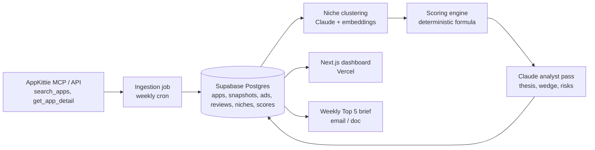

# Idea Incubation Engine: Architecture Plan

**Goal:** Turn AppKittie market data into a ranked shortlist of 5 app opportunities that can plausibly reach **$30K to $50K monthly revenue** with a small team.

Status: architecture plan (v0). No code yet, by design.

---

## 1. What we're building

A weekly pipeline that pulls new and fast-growing apps from AppKittie, groups them into niches, scores each niche on "can we win $30-50K/mo here," and publishes a ranked Top 5 brief with evidence.

## 2. The target, back-solved

| Model | Price | Net after store fee (~85% on small-business program) | Paying users needed for $30K / $50K |
|---|---|---|---|
| Monthly sub | $9.99 | ~$8.50 | ~3,500 / ~5,900 |
| Annual sub | $49.99 | ~$3.55/mo | ~8,500 / ~14,100 |
| Weekly sub (AI utility pattern) | $4.99 | ~$18/mo | ~1,700 / ~2,800 |

So the filter is not "biggest apps." It is **niches where a #3-#5 player earns $30-50K/mo**, which means the leader typically earns $150K+ and the category is not winner-take-all.

## 3. System overview

### Components

| Layer | Choice | Why |
|---|---|---|
| Data source | AppKittie MCP (`https://mcp.appkittie.com`, bearer API key) | Already exposes revenue, downloads, growth, Meta ads, IAPs, 30+ filters |
| Scheduler | Vercel Cron (or Supabase `pg_cron` + Edge Function) | Zero infra; weekly cadence is enough |
| Storage | Supabase Postgres | Time-series snapshots let us compute our own growth, not just trust a 30d figure |
| Intelligence | Claude (Opus for analyst pass, Haiku for bulk tagging) | Niche naming, review pain mining, opportunity thesis |
| UI | Next.js on Vercel | Ranked board, niche drill-down, "pursue / park / kill" decisions |
| Output | Weekly brief (email or Claude Doc) | The thing you actually read |

## 4. Data flow and credit budget

AppKittie charges ~1 credit per app returned by search and 1 per detail lookup, so the pipeline is **funnel-shaped** to control spend:

1. **Broad sweep (≈500 credits/wk):** `search_apps` with the filters in the screenshot: released last 90-180d, exclude Games, EN primary language, has Meta ads, min revenue ≥ $20K.
2. **Shortlist (≈50 credits/wk):** `get_app_detail` only on the top ~50 by revenue-per-download and growth.
3. **Snapshot:** store every app weekly so growth and ad-spend trend are ours.

## 5. Data model (logical)

- `apps` (id, store, name, developer, category, release_date, price model)
- `app_snapshots` (app_id, week, revenue, downloads, rating, review_count, growth_30d)
- `app_ads` (app_id, network, active_creatives, first_seen, last_seen)
- `app_reviews` (app_id, rating, text, sentiment, pain_tags)
- `niches` (id, label, description, member app_ids)
- `niche_scores` (niche_id, week, each sub-score, total, Claude thesis)
- `decisions` (niche_id, status: pursue / park / kill, notes)

## 6. Scoring model

Opportunity Score (0-100) = weighted sum, computed in SQL so it is auditable. Claude explains the score, it does not set it.

| Factor | Weight | Signal from AppKittie |
|---|---|---|
| Revenue headroom | 25% | Niche total revenue; leader rev ≥ 3-5× our target |
| Momentum | 20% | 30d growth, new entrants in last 90d still making money |
| Monetization efficiency | 15% | Revenue / download (e.g. CutAI: $370K on 16K downloads = premium pricing works) |
| Paid acquisition proof | 15% | Active Meta / TikTok ads sustained > 60 days = unit economics close |
| Fragmentation | 10% | No single app > 60% of niche revenue; no Big Tech owner |
| Quality gap | 10% | Leader rating < 4.5 or recurring review complaints |
| Build feasibility | 5% | Claude-estimated MVP effort (≤ 4 weeks scores high) |

**Hard filters (auto-kill):** Big Tech publishers (e.g. Meta), licensed-content dependence (IPTV with copyright risk), regulated categories (medical diagnosis, lending), games.

## 7. Claude analyst pass (per top-15 niche)

Sample prompt:

> You are an app-market analyst. Given these 5-12 apps in one niche with revenue, downloads, growth, ad activity, and 200 sampled reviews: (1) name the niche in 4 words, (2) list the top 3 user pain points with review quotes, (3) propose one differentiated wedge we can ship in 4 weeks, (4) estimate realistic month-6 revenue for a new entrant with $5K/mo ad spend, (5) list the 2 biggest kill risks. Return JSON.

## 8. Early read from the screenshot (hypotheses, not conclusions)

| App | Signal | Read |
|---|---|---|
| CarTV IPTV Player | $509K, 1M dl, +16% | Big demand, but IPTV carries content/legal risk. Likely auto-kill. |
| CutAI Video Editor | $370K on 16K dl | Very high ARPU. AI video utilities monetize hard. Strong pattern. |
| HolyNote Sermon Notes | $198K, 174K dl, 4.8★ | Faith-vertical niche, small team, loyal users. Classic $30-50K/mo follower space. |
| Muse from Meta | $178K | Big Tech. Exclude. |
| HeyRua Irish Learning | $137K on 26K dl | Niche-language learning pays. Replicable to other heritage languages. |

Pattern worth testing: **narrow vertical + AI feature + subscription + Meta ads**. The engine should confirm or kill this with 500+ apps, not 5.

Note: confirm with AppKittie whether the Revenue column is monthly or lifetime-since-release. It changes the thresholds above by 3×.

## 9. Implementation plan

| Phase | Scope | Effort |
|---|---|---|
| **MVP (48 hrs)** | Script pulls 500 apps via MCP → Supabase; scoring SQL; Claude names niches and writes Top 5 brief as Markdown | 2 days |
| **V1 (1-2 wks)** | Weekly cron, snapshots, review mining, Next.js board with pursue/park/kill | 1-2 wks |
| **Scale** | Keyword demand (AppKittie keyword tools), ad creative analysis, auto-generated landing page to smoke-test demand per idea | ongoing |

Deferred to V2: TikTok ads, multi-country, creator contacts, automated landing-page tests.

## 10. Risks

| Risk | Mitigation |
|---|---|
| AppKittie revenue figures are estimates | Use relative ranking, cross-check top picks against a second source before committing build time |
| Credit burn | Funnel design above; cap credits per run in config |
| Survivorship bias (we only see apps that worked) | Track apps that were in the sweep and later dropped; include failure rate per niche |
| Pretty score, wrong idea | Every Top 5 pick must pass a $500 smoke test (landing page + Meta ads) before any build |

## 11. What's needed to start

1. AppKittie API key (Dashboard → API) and current credit balance.
2. Supabase project for the engine.
3. Anthropic API key.
4. Network access to `mcp.appkittie.com` from the build environment.
